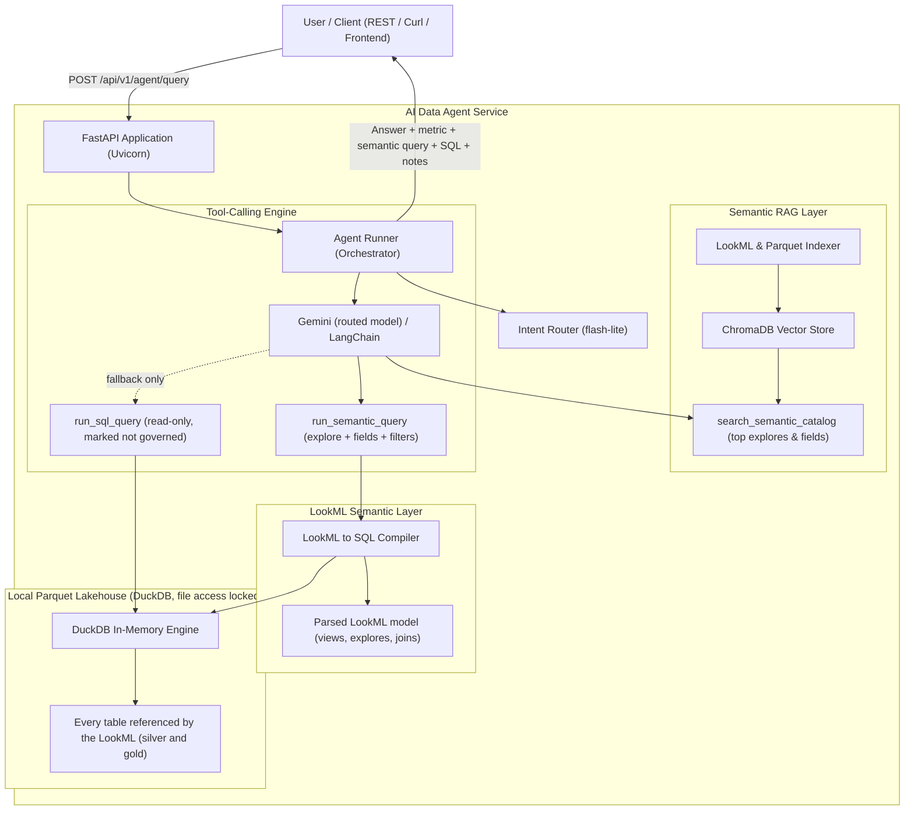

# AI-Native Semantic Query Agent & RAG Microservice

[](https://fastapi.tiangolo.com)
[](https://duckdb.org)
[](https://www.trychroma.com)
[](https://python.langchain.com)
[](https://ai.google.dev)
[](https://www.python.org/)

An enterprise-grade, AI-native semantic query agent and RAG microservice built with **FastAPI**, **LangChain**, **ChromaDB**, and **DuckDB**. 

The microservice bridges verified **LookML semantic definitions** (from [wallet-lookml](https://github.com/carlosgilroa/wallet-lookml)) directly to local columnar Parquet lakehouse storage (from [wallet](https://github.com/carlosgilroa/wallet)), enabling accurate natural language text-to-SQL analytics without hallucinations or metric drift.

---

## Architecture Overview

The model never writes metric SQL. It picks an explore, fields and filters from the LookML
semantic layer, and a deterministic compiler turns that choice into DuckDB SQL. The same
question always produces the same SQL, and every number uses the official LookML definition.



---

## Key Features

1. **LookML to SQL compiler** (`app/semantic/`):
   - Parses views, explores, joins, dimension groups, measure filters and derived tables with `lkml`.
   - Compiles `{explore, fields, filters, sorts, limit}` into DuckDB SQL, joining only the views it needs.
   - Uses symmetric aggregates when a join fans out rows, so sums are never double counted.
   - Looker-style filters: `Groceries,Rent`, `-Rent`, `%uber%`, `^,` to escape a comma, `yes`/`no`, `>1000000`, `[100,500]`, and dates such as `2026-09`, `2026-Q3`, `2026-01 through 2026-03`, `last month`, `this year`, `last 3 months`.
   - Date rule: "last month" is the previous full calendar month, "this month" is the current month to date.
   - Unknown or hidden fields return an error with suggestions, so the model can correct itself.
   - Answers note when a period is only partly covered by the data.
2. **RAG with Chroma keeps the prompt small**:
   - The router turns the question into a search phrase, and Chroma returns only the most relevant explores, measures and dimensions (`SEMANTIC_SEARCH_TOP_K`, default 12). Input tokens stay flat as the semantic layer grows.
   - The catalog is rebuilt automatically when any `.lkml` file changes.
3. **Intent router**: `out_of_scope` (no tools), `capabilities` (router model), `simple_query` (simple model, 5 steps) and `complex_query` (main model, 8 steps).
4. **Exploratory questions**: when no explore fits, the agent may run read-only raw SQL (`ALLOW_RAW_SQL_FALLBACK`). Those answers say they are not governed metrics and come back with `governed: false`.
5. **Traceable answers**: every response carries the semantic query, the LookML fields with their definitions, the compiled SQL, the rows, coverage notes and whether the numbers are governed.
6. **Locked-down DuckDB**: tables are loaded into memory at start, then external file access and configuration changes are disabled, so agent SQL can't read other files on the machine. Only `SELECT` and `WITH` statements run.
7. **Golden questions**: 29 questions with hand-written reference SQL. The compiler is checked against them for free on every test run; the full agent is checked through Gemini only on demand.
8. **Session memory**: 10-turn window per `session_id`, including the last semantic query for follow-ups.

---

## Repository Structure

```
ai-data-agent/
├── app/
│   ├── main.py                     # FastAPI application entrypoint & lifespan
│   ├── core/config.py              # Pydantic BaseSettings environment config
│   ├── schemas/                    # Pydantic models (catalog, query, response)
│   ├── semantic/
│   │   ├── model.py                # Parsed LookML model: views, fields, explores, joins
│   │   ├── compiler.py             # Semantic query to DuckDB SQL
│   │   ├── dates.py                # Date filter expressions ("last month", "2026-Q3", ...)
│   │   └── service.py              # Runs compiled queries, coverage notes, explore descriptions
│   ├── rag/
│   │   ├── store.py                # ChromaDB vector store & memory fallback
│   │   └── indexer.py              # LookML & lakehouse metadata indexer
│   ├── agent/
│   │   ├── prompts.py              # System prompt (explores, filter grammar, answer format)
│   │   ├── router.py               # Intent router
│   │   ├── runner.py               # Tool-calling loop, answer trace & session memory
│   │   └── tools/
│   │       ├── duckdb_tool.py      # Locked-down DuckDB engine over Parquet
│   │       └── rag_tool.py         # Semantic catalog search
│   └── api/v1/endpoints/
│       ├── health.py, catalog.py   # Health & catalog
│       ├── agent.py                # Natural language query, sessions & direct SQL
│       └── semantic.py             # Direct semantic queries (no LLM)
├── docs/                           # Architecture & API documentation
├── scripts/run_indexer.py          # CLI indexer
├── tests/
│   ├── golden/questions.json       # Golden questions with reference SQL
│   ├── test_golden_compiler.py     # Compiler vs reference SQL (free)
│   ├── test_golden_live.py         # Agent vs reference SQL (Gemini, opt-in)
│   └── test_agent.py, test_duckdb.py, test_indexer.py, test_schemas.py
├── pytest.ini                      # `live` marker, skipped by default
├── .env.example
└── requirements.txt
```

---

## Quickstart

### 1. Clone & Set Up Environment

```bash
git clone https://github.com/carlosgilroa/ai-data-agent.git
cd ai-data-agent

# Set up virtual environment
python -m venv venv
.\venv\Scripts\Activate.ps1   # On Windows
# or source venv/bin/activate  # On Linux/macOS

# Install dependencies
pip install -r requirements.txt
```

### 2. Configure Environment

Copy `.env.example` to `.env`:
```bash
cp .env.example .env
```

Set your Google AI Studio API key in `.env`:
```ini
GEMINI_API_KEY=your_gemini_api_key_here
GEMINI_ROUTER_MODEL=gemini-3.1-flash-lite
GEMINI_SIMPLE_MODEL=gemini-3.5-flash-lite
GEMINI_MODEL=gemini-3.8-flash
RAG_TOP_K=5
RAG_MIN_SIMILARITY=0.28
WALLET_DATA_DIR=C:/projects/wallet/data
LOOKML_DIR=C:/projects/wallet-lookml
AGENT_TODAY=                  # optional fixed date for "last month" etc.
ALLOW_RAW_SQL_FALLBACK=True
SEMANTIC_SEARCH_TOP_K=12
```
*(Note: A valid `GEMINI_API_KEY` is required to run the autonomous agent. If omitted or unconfigured, the endpoint explicitly returns HTTP 400 Bad Request to prevent ungrounded heuristics.)*

### 3. Run Semantic Indexer

Build the vector index from LookML definitions and Parquet schemas:
```bash
python scripts/run_indexer.py
```

### 4. Start Development Server

```bash
uvicorn app.main:app --reload --host 0.0.0.0 --port 8000
```
Open **[http://localhost:8000/docs](http://localhost:8000/docs)** to test the interactive Swagger UI.

### 5. Run Test Suite

```bash
python -m pytest            # free: unit tests + golden compiler checks, no Gemini calls
python -m pytest -m live    # spends Gemini credits: the agent answers the golden questions
GOLDEN_IDS=spend_sep,aug_vs_sep python -m pytest -m live   # only some golden questions
```

---

## API Endpoints

### 1. Health Check
`GET /api/v1/health`
```json
{
  "status": "healthy",
  "version": "0.1.0",
  "duckdb_connected": true,
  "tables_available": [
    "master_records",
    "dim_accounts",
    "dim_categories",
    "dim_labels",
    "fx_rates",
    "mart_monthly_pnl",
    "mart_expense_summary",
    "pdt_category_mom_velocity"
  ],
  "vector_store_ready": true,
  "gemini_configured": false
}
```

### 2. Semantic Catalog Search
`GET /api/v1/catalog/search?q=total+spend`
Returns matching LookML explores, measures and dimensions.

### 3. Semantic Query (no LLM, free)
`POST /api/v1/semantic/query`
```json
{
  "explore": "fct_transactions",
  "fields": ["fct_transactions.total_spend_cop"],
  "filters": {"fct_transactions.transaction_month": "last month"}
}
```
Returns the rows, the compiled SQL, the field definitions and coverage notes.
`GET /api/v1/semantic/explores` lists explores and `GET /api/v1/semantic/explores/{explore}` lists an explore's fields.

### 4. Agent Query
`POST /api/v1/agent/query`
```json
{ "query": "How much did I spend last month?", "explain": true }
```
**Response** (shortened, with `AGENT_TODAY=2026-10-26`):
```json
{
  "query": "How much did I spend last month?",
  "intent": "simple_query",
  "answer": "You spent 12,417,134 COP in September 2026.\nMetric: total spend, net of refunds, excluding transfers.",
  "semantic_query": {
    "explore": "fct_transactions",
    "fields": ["fct_transactions.total_spend_cop"],
    "filters": {"fct_transactions.transaction_month": "last month"}
  },
  "fields_used": [
    {"name": "fct_transactions.total_spend_cop", "kind": "measure", "type": "number", "description": "..."}
  ],
  "governed": true,
  "notes": [],
  "sql": "SELECT ... FROM master_records AS fct_transactions WHERE ...",
  "data": [{"fct_transactions.total_spend_cop": 12417133.52}],
  "thought_steps": ["..."],
  "execution_time_ms": 2140.5
}
```
