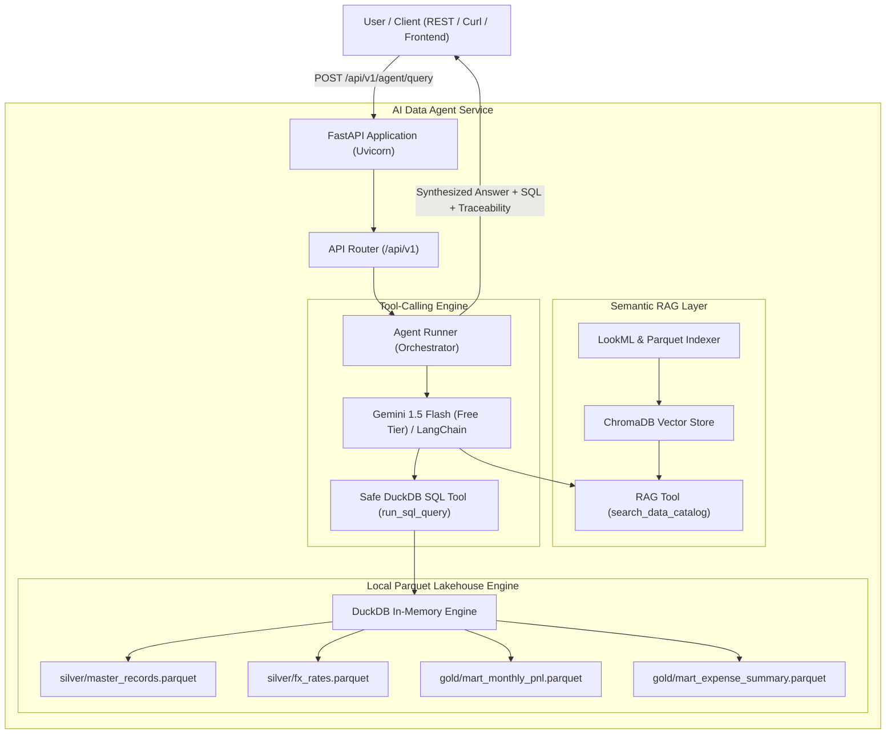

# AI-Native Semantic Query Agent & RAG Microservice

[](https://fastapi.tiangolo.com)
[](https://duckdb.org)
[](https://www.trychroma.com)
[](https://python.langchain.com)
[](https://ai.google.dev)
[](https://www.python.org/)

An enterprise-grade, AI-native semantic query agent and RAG microservice built with **FastAPI**, **LangChain**, **ChromaDB**, and **DuckDB**. 

The microservice bridges verified **LookML semantic definitions** (from [wallet-lookml](https://github.com/carlosgilroa/wallet-lookml)) directly to local columnar Parquet lakehouse storage (from [wallet](https://github.com/carlosgilroa/wallet)), enabling accurate natural language text-to-SQL analytics without hallucinations or metric drift.

---

## Architecture Overview



---

## Key Features

1. **Autonomous ReAct Tool-Calling Loop**:
   - Binds first-class LangChain tools (`search_data_catalog`, `run_sql_query`) directly to **Gemini 1.5 Flash**.
   - Dynamically inspects LookML definitions, generates SQL, inspects results, and auto-corrects SQL errors.
   - Provides explicit error feedback (`400 Bad Request`) when `GEMINI_API_KEY` is missing, eliminating brittle heuristics.
2. **Resilient Pure-Python DuckDB Lakehouse Execution**:
   - In-process execution directly against local Parquet files, executing queries in **<10 ms**.
   - Native row serialization without pandas dependency, ensuring maximum speed and zero environment conflicts.
3. **LookML Semantic Anchoring**:
   - Parses native LookML `.lkml` files to extract measures, dimensions, and business rules (e.g. `is_transfer = false`, two-tier accounting definitions).
   - Ingests semantic definitions into ChromaDB, grounding LLM reasoning and eliminating hallucinations.
4. **Safe AST-Guarded SQL Execution**:
   - Strict read-only enforcement allowing only `SELECT` and `WITH` statements.
   - Regex-based AST safety blocking mutation keywords (`DROP`, `DELETE`, `INSERT`, `ALTER`, `ATTACH`).
5. **Pydantic v2 Type-Safe Schemas & Interactive Swagger**:
   - End-to-end data contracts for `QueryRequest`, `QueryResponse`, `AgentThoughtStep`, and `CatalogItem`.
   - Auto-generated interactive API docs accessible out-of-the-box at `/docs`.

---

## Repository Structure

```
ai-data-agent/
├── app/
│   ├── main.py                     # FastAPI application entrypoint & lifespan
│   ├── core/
│   │   ├── config.py               # Pydantic BaseSettings environment config
│   ├── schemas/
│   │   ├── catalog.py              # Pydantic models for semantic catalog
│   │   └── query.py                # Pydantic models for queries & thought steps
│   ├── rag/
│   │   ├── store.py                # ChromaDB vector store manager & memory fallback
│   │   └── indexer.py              # LookML & Lakehouse metadata extractor
│   ├── agent/
│   │   ├── prompts.py              # System prompt & financial text-to-SQL few-shots
│   │   ├── runner.py               # Agent orchestrator with tool calling & fallback
│   │   └── tools/
│   │       ├── duckdb_tool.py      # Read-only DuckDB SQL engine over Parquets
│   │       └── rag_tool.py         # Semantic catalog search tool
│   └── api/
│       └── v1/
│           ├── router.py           # API v1 router
│           └── endpoints/
│               ├── health.py       # Lakehouse and vector store health check
│               ├── catalog.py      # Semantic catalog endpoints
│               └── agent.py        # Natural language query & direct SQL endpoints
├── docs/                           # Dedicated architecture & API documentation
│   ├── README.md                   # Documentation hub & sitemap
│   └── api/
│       └── endpoints_reference.md  # Detailed REST endpoints & contracts
├── scripts/
│   ├── run_indexer.py              # CLI indexer test runner
│   └── run_dev.ps1                 # PowerShell venv setup & uvicorn dev runner
├── tests/
│   ├── test_duckdb.py              # Unit tests for DuckDB engine & safety guards
│   ├── test_schemas.py             # Unit tests for Pydantic data models
│   └── test_indexer.py             # Unit tests for LookML RAG indexing
├── .env.example                    # Environment template
├── .gitignore                      # Python & cache ignore rules
├── requirements.txt                # Production and development dependencies
└── README.md                       # Architecture & documentation
```

---

## Quickstart

### 1. Clone & Set Up Environment

```bash
git clone https://github.com/carlosgilroa/ai-data-agent.git
cd ai-data-agent

# Set up virtual environment
python -m venv venv
.\venv\Scripts\Activate.ps1   # On Windows
# or source venv/bin/activate  # On Linux/macOS

# Install dependencies
pip install -r requirements.txt
```

### 2. Configure Environment

Copy `.env.example` to `.env`:
```bash
cp .env.example .env
```

Optionally set your Google AI Studio Free Tier key:
```ini
GEMINI_API_KEY=your_gemini_api_key_here
GEMINI_MODEL=gemini-3.8-flash
WALLET_DATA_DIR=C:/projects/wallet/data
LOOKML_DIR=C:/projects/wallet-lookml
```
*(Note: If no API key is provided, the service runs in an intelligent semantic heuristic mode, allowing full API testing and verification offline.)*

### 3. Run Semantic Indexer

Build the vector index from LookML definitions and Parquet schemas:
```bash
python scripts/run_indexer.py
```

### 4. Start Development Server

```bash
uvicorn app.main:app --reload --host 0.0.0.0 --port 8000
```
Open **[http://localhost:8000/docs](http://localhost:8000/docs)** to test the interactive Swagger UI.

### 5. Run Test Suite

```bash
python -m pytest tests -v
```

---

## API Endpoints

### 1. Health Check
`GET /api/v1/health`
```json
{
  "status": "healthy",
  "version": "0.1.0",
  "duckdb_connected": true,
  "tables_available": [
    "master_records",
    "fx_rates",
    "mart_monthly_pnl",
    "mart_expense_summary"
  ],
  "vector_store_ready": true,
  "gemini_configured": false
}
```

### 2. Semantic Catalog Search
`GET /api/v1/catalog/search?q=operational+burn+rate`
Returns matching LookML metrics, such as `tier1_operational_spend_usd` and associated SQL formulas.

### 3. Agent Query
`POST /api/v1/agent/query`
```json
{
  "query": "What is my net cashflow and savings rate by month?",
  "explain": true
}
```
**Response**:
```json
{
  "query": "What is my net cashflow and savings rate by month?",
  "answer": "Based on reconciled monthly P&L records (via LookML mart_monthly_pnl):\n- Latest Month (2026-09): Net Cash Flow was -8,926,969.00 with a savings rate of -308.6%.\n- Total operating income was 1,351,550.00 against operational expenses of 5,522,875.06.",
  "sql": "SELECT year_month, operating_income, operational_expenses, net_cashflow, savings_rate_pct FROM mart_monthly_pnl ORDER BY year_month ASC LIMIT 12;",
  "data": [
    {
      "year_month": "2026-01",
      "operating_income": 12850000.0,
      "operational_expenses": 3482100.0,
      "net_cashflow": 9367900.0,
      "savings_rate_pct": 72.9
    }
  ],
  "thought_steps": [
    {
      "step_number": 1,
      "tool": "search_data_catalog",
      "tool_input": { "query": "What is my net cashflow and savings rate by month?" },
      "tool_output": "Matched mart_monthly_pnl and savings_rate_percentage",
      "thought": "Searching semantic catalog for metrics and dimensions..."
    },
    {
      "step_number": 2,
      "tool": "run_sql_query",
      "tool_input": { "sql": "SELECT year_month, operating_income, operational_expenses, net_cashflow, savings_rate_pct FROM mart_monthly_pnl ORDER BY year_month ASC LIMIT 12;" },
      "tool_output": "Returned 9 rows. Columns: ['year_month', 'operating_income', 'operational_expenses', 'net_cashflow', 'savings_rate_pct']",
      "thought": "Executing LookML-aligned SQL against local DuckDB Lakehouse..."
    }
  ],
  "execution_time_ms": 6.44
}
```

---

## PoC 2 Roadmap & Milestones

- [x] **Milestone 2.1**: Scaffolding, Pydantic v2 Schemas & Safe In-Memory DuckDB Engine
- [x] **Milestone 2.2**: LookML Semantic RAG Indexer & ChromaDB Vector Store Integration
- [x] **Milestone 2.3**: Tool-Calling Agent Execution Loop (LangChain / Gemini 1.5 Flash)
- [x] **Milestone 2.4**: FastAPI Microservice & REST APIs (Swagger, Uvicorn, Health checks)
- [ ] **Milestone 2.5**: End-to-End Evaluation, Golden P&L Reconciliation & Dockerization

---

## Author
**Carlos Gil Roa**  
*Senior Data & AI Analytics Engineer*  
- Portfolio: [carlosgilroa.github.io](https://carlosgilroa.github.io)
- GitHub: [@carlosgilroa](https://github.com/carlosgilroa)
- LinkedIn: [carlos-gil-roa](https://linkedin.com/in/carlos-gil-roa)
