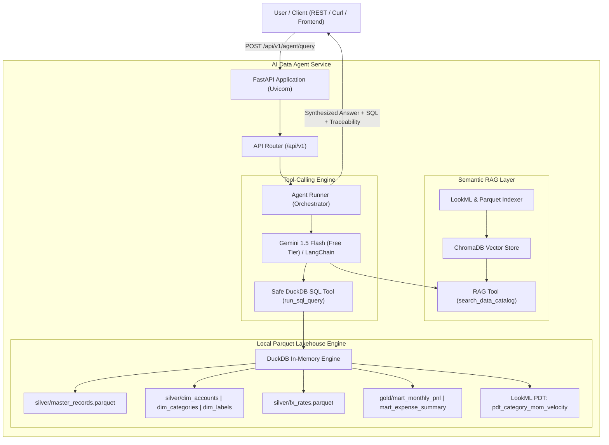

# AI-Native Semantic Query Agent & RAG Microservice

[](https://fastapi.tiangolo.com)
[](https://duckdb.org)
[](https://www.trychroma.com)
[](https://python.langchain.com)
[](https://ai.google.dev)
[](https://www.python.org/)

An enterprise-grade, AI-native semantic query agent and RAG microservice built with **FastAPI**, **LangChain**, **ChromaDB**, and **DuckDB**. 

The microservice bridges verified **LookML semantic definitions** (from [wallet-lookml](https://github.com/carlosgilroa/wallet-lookml)) directly to local columnar Parquet lakehouse storage (from [wallet](https://github.com/carlosgilroa/wallet)), enabling accurate natural language text-to-SQL analytics without hallucinations or metric drift.

---

## Architecture Overview



---

## Key Features

1. **Two-Step Intent Router & Autonomous ReAct Loop**:
   - Classifies incoming queries via `gemini-3.1-flash-lite` into `out_of_scope` (`0` steps), `capabilities` (`2` steps on `gemini-3.1-flash-lite`), `simple_query` (`6` steps on `gemini-3.5-flash-lite`), or `complex_query` (`8` steps on `gemini-3.8-flash`).
   - Performs **Zero-Cost Semantic Query Decomposition**: extracts an enriched `metric_search_phrase` (dense vector search phrase) and `entity_keywords` (dimension filters) alongside the routing classification with zero extra API latency.
   - Binds discrete modular semantic tools (`search_data_catalog`, `get_table_schema`, `get_dimension_values`, `run_sql_query`) directly to the routed Gemini model with unrestricted multi-step introspection.
   - Dynamically injects a **Lakehouse Context Envelope** (recorded date bounds from DuckDB + semantic decomposition hints) into runtime system context for zero-shot temporal anchoring without hardcoded dates.
   - Minimalist zero-shot system prompt without hardcoded schemas or tools; uses native API tool-binding schema definitions and strict financial grounding against hallucinations.
   - Provides explicit error feedback (`400 Bad Request`) when `GEMINI_API_KEY` is missing, eliminating brittle heuristics.
2. **Multi-Turn Conversational Session Memory & Observability**:
   - Preserves dialogue history keyed by `session_id` using a 10-turn (20-message) sliding context window.
   - Session inspection endpoint (`GET /api/v1/agent/session/{session_id}`) for live dialogue review.
   - Session reset endpoint (`DELETE /api/v1/agent/session/{session_id}`) for clearing conversation state.
   - Real-time structured request/response logging for query and answer observability.
3. **Resilient Pure-Python DuckDB Lakehouse Execution**:
   - In-process execution directly against local Parquet files, executing queries in **<10 ms**.
   - Native row serialization without pandas dependency, ensuring maximum speed and zero environment conflicts.
4. **LookML as Single Source of Truth & Cosine Similarity Filtering**:
   - Wipes ChromaDB clean (`vector_store.clear()`) on every re-index and uses the native `lkml` parser to extract measures (with `filters__all` and aggregation wrappers), dimensions, `dimension_groups`, `CASE` statements, derived tables (`pdt_category_mom_velocity`), explores, and joins from `projects/wallet-lookml`.
   - Maps LookML `sql_table_name` definitions directly (via `_strip_lookml_table_macro`) to the 7 physical Parquet lakehouse tables (`master_records`, `dim_accounts`, `dim_categories`, `dim_labels`, `fx_rates`, `mart_monthly_pnl`, `mart_expense_summary`) without hardcoded view-resolution heuristics.
   - Computes cosine similarity (`1 - distance`), filters out low-relevance noise using an absolute noise floor (`0.20`) and dynamic 80% relative threshold, with decoupled on-demand schema inspection via `get_table_schema` and categorical entity resolution via `get_dimension_values`.
5. **Safe AST-Guarded SQL Execution**:
   - Strict read-only enforcement allowing only `SELECT` and `WITH` statements.
   - Regex-based AST safety blocking mutation keywords (`DROP`, `DELETE`, `INSERT`, `ALTER`, `ATTACH`).
6. **Pydantic v2 Type-Safe Schemas & Interactive Swagger**:
   - End-to-end data contracts for `QueryRequest`, `QueryResponse`, `AgentThoughtStep`, and `CatalogItem`.
   - Auto-generated interactive API docs accessible out-of-the-box at `/docs`.

---

## Repository Structure

```
ai-data-agent/
├── app/
│   ├── main.py                     # FastAPI application entrypoint & lifespan
│   ├── core/
│   │   ├── config.py               # Pydantic BaseSettings environment config
│   ├── schemas/
│   │   ├── catalog.py              # Pydantic models for semantic catalog
│   │   └── query.py                # Pydantic models for queries & thought steps
│   ├── rag/
│   │   ├── store.py                # ChromaDB vector store manager & memory fallback
│   │   └── indexer.py              # LookML & Lakehouse metadata extractor
│   ├── agent/
│   │   ├── prompts.py              # Minimalist system prompt (no static schemas)
│   │   ├── router.py               # Two-step IntentRouter (gemini-3.1-flash-lite)
│   │   ├── runner.py               # Agent orchestrator with routed ReAct loop & session memory
│   │   └── tools/
│   │       ├── duckdb_tool.py      # Read-only DuckDB SQL engine over Parquets
│   │       └── rag_tool.py         # Semantic catalog search tool
│   └── api/
│       └── v1/
│           ├── router.py           # API v1 router
│           └── endpoints/
│               ├── health.py       # Lakehouse and vector store health check
│               ├── catalog.py      # Semantic catalog endpoints
│               └── agent.py        # Natural language query, session inspect/reset & direct SQL
├── docs/                           # Dedicated architecture & API documentation
│   ├── README.md                   # Documentation hub & sitemap
│   ├── api/
│   │   └── endpoints_reference.md  # Detailed REST endpoints & contracts
│   └── architecture/
│       ├── agent_architecture.md   # Autonomous ReAct loop, session memory & SQL safety
│       └── semantic_rag_indexer.md # LookML AST parser, views/models/joins & ChromaDB RAG
├── scripts/
│   ├── run_indexer.py              # CLI indexer test runner
│   └── run_dev.ps1                 # PowerShell venv setup & uvicorn dev runner
├── tests/
│   ├── test_agent.py               # Unit tests for ReAct runner, tools & session memory
│   ├── test_duckdb.py              # Unit tests for DuckDB engine & safety guards
│   ├── test_schemas.py             # Unit tests for Pydantic data models
│   └── test_indexer.py             # Unit tests for LookML RAG indexing
├── .env.example                    # Environment template
├── .gitignore                      # Python & cache ignore rules
├── requirements.txt                # Production and development dependencies
└── README.md                       # Architecture & documentation
```

---

## Quickstart

### 1. Clone & Set Up Environment

```bash
git clone https://github.com/carlosgilroa/ai-data-agent.git
cd ai-data-agent

# Set up virtual environment
python -m venv venv
.\venv\Scripts\Activate.ps1   # On Windows
# or source venv/bin/activate  # On Linux/macOS

# Install dependencies
pip install -r requirements.txt
```

### 2. Configure Environment

Copy `.env.example` to `.env`:
```bash
cp .env.example .env
```

Set your Google AI Studio API key in `.env`:
```ini
GEMINI_API_KEY=your_gemini_api_key_here
GEMINI_ROUTER_MODEL=gemini-3.1-flash-lite
GEMINI_SIMPLE_MODEL=gemini-3.5-flash-lite
GEMINI_MODEL=gemini-3.8-flash
RAG_TOP_K=5
RAG_MIN_SIMILARITY=0.28
WALLET_DATA_DIR=C:/projects/wallet/data
LOOKML_DIR=C:/projects/wallet-lookml
```
*(Note: A valid `GEMINI_API_KEY` is required to run the autonomous agent. If omitted or unconfigured, the endpoint explicitly returns HTTP 400 Bad Request to prevent ungrounded heuristics.)*

### 3. Run Semantic Indexer

Build the vector index from LookML definitions and Parquet schemas:
```bash
python scripts/run_indexer.py
```

### 4. Start Development Server

```bash
uvicorn app.main:app --reload --host 0.0.0.0 --port 8000
```
Open **[http://localhost:8000/docs](http://localhost:8000/docs)** to test the interactive Swagger UI.

### 5. Run Test Suite

```bash
python -m pytest tests -v
```

---

## API Endpoints

### 1. Health Check
`GET /api/v1/health`
```json
{
  "status": "healthy",
  "version": "0.1.0",
  "duckdb_connected": true,
  "tables_available": [
    "master_records",
    "dim_accounts",
    "dim_categories",
    "dim_labels",
    "fx_rates",
    "mart_monthly_pnl",
    "mart_expense_summary",
    "pdt_category_mom_velocity"
  ],
  "vector_store_ready": true,
  "gemini_configured": false
}
```

### 2. Semantic Catalog Search
`GET /api/v1/catalog/search?q=operational+burn+rate`
Returns matching LookML metrics, such as `tier1_operational_spend_usd` and associated SQL formulas.

### 3. Agent Query
`POST /api/v1/agent/query`
```json
{
  "query": "What is my net cashflow and savings rate by month?",
  "explain": true
}
```
**Response**:
```json
{
  "query": "What is my net cashflow and savings rate by month?",
  "answer": "Based on reconciled monthly P&L records (via LookML mart_monthly_pnl):\n- Latest Month (2026-09): Net Cash Flow was -8,926,969.00 with a savings rate of -308.6%.\n- Total operating income was 1,351,550.00 against operational expenses of 5,522,875.06.",
  "sql": "SELECT year_month, operating_income, operational_expenses, net_cashflow, savings_rate_pct FROM mart_monthly_pnl ORDER BY year_month ASC LIMIT 12;",
  "data": [
    {
      "year_month": "2026-01",
      "operating_income": 12850000.0,
      "operational_expenses": 3482100.0,
      "net_cashflow": 9367900.0,
      "savings_rate_pct": 72.9
    }
  ],
  "thought_steps": [
    {
      "step_number": 1,
      "tool": "search_data_catalog",
      "tool_input": { "query": "What is my net cashflow and savings rate by month?" },
      "tool_output": "Matched mart_monthly_pnl and savings_rate_percentage",
      "thought": "Searching semantic catalog for metrics and dimensions..."
    },
    {
      "step_number": 2,
      "tool": "run_sql_query",
      "tool_input": { "sql": "SELECT year_month, operating_income, operational_expenses, net_cashflow, savings_rate_pct FROM mart_monthly_pnl ORDER BY year_month ASC LIMIT 12;" },
      "tool_output": "Returned 9 rows. Columns: ['year_month', 'operating_income', 'operational_expenses', 'net_cashflow', 'savings_rate_pct']",
      "thought": "Executing LookML-aligned SQL against local DuckDB Lakehouse..."
    }
  ],
  "execution_time_ms": 6.44
}
```
