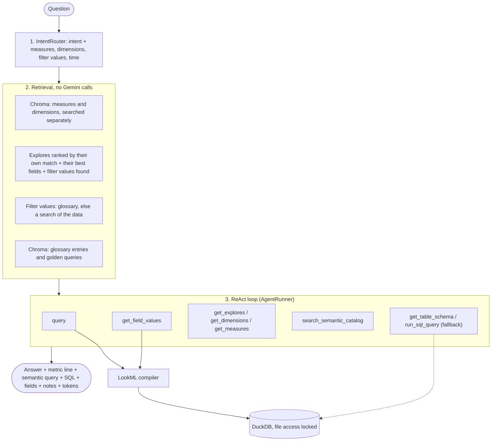

# Agent Architecture: a Looker-Style Semantic Layer Agent

This document describes how the agent in `app/agent/` and `app/semantic/` turns a question into a number. It is modelled on [Conversational Analytics in Looker](https://docs.cloud.google.com/looker/docs/2608/conversational-analytics-overview), simplified:

- **Semantic layer (LookML):** the model never writes metric SQL. It chooses an explore, fields and filters, and a deterministic compiler writes the SQL, as Looker does.
- **RAG (Chroma):** for each question, Chroma retrieves the explores and fields that fit, plus glossary entries and verified example queries, so the prompt stays small as the LookML grows.
- **ReAct agent:** the model reasons in a loop with Looker-like tools (get_explores, get_dimensions, get_measures, get_field_values, query) until it can answer.

---

## 1. System Overview

---

## 2. Intent Router (`app/agent/router.py`)

The router model returns a `RouterDecision` that splits the question in LookML terms:

| Field | Example for "How much did I spend on restaurants last month?" |
|:---|:---|
| `intent` | `simple_query` |
| `measures` | `["total spend"]` |
| `dimensions` | `[]` (no group-by) |
| `filter_values` | `["restaurants"]` |
| `time_period` | `"last month"` |

| Intent | Model | Tools | Steps |
|:---|:---|:---|:---:|
| `out_of_scope` | router model | none | 0 |
| `capabilities` | router model | `get_explores`, `get_measures`, `get_dimensions` | 2 |
| `simple_query` | simple model | all semantic tools (+ raw SQL fallback) | 5 |
| `complex_query` | main model | all semantic tools (+ raw SQL fallback) | 8 |

The raw SQL tools are only bound when `ALLOW_RAW_SQL_FALLBACK=True`.

---

## 3. Retrieval (`app/agent/tools/rag_tool.py`)

Retrieval runs in code before the loop and costs no Gemini tokens:

1. **Measures and dimensions are searched separately** in Chroma, each with its own phrase from the router, so one type never crowds out the other. No dimension search runs when the question has no group-by.
2. **Explores are picked first, Looker-style.** Each explore scores its own similarity to the question, plus its best measure, its best dimension (half weight) and half a point for each filter value found in it. The top `RETRIEVAL_EXPLORES` (default 3) are kept, and only fields inside them are shown: up to `RETRIEVAL_MEASURES` and `RETRIEVAL_DIMENSIONS` (default 5 each).
3. **Filter values are resolved.** Each value the user mentioned is matched against the glossary first ("eating out" means category_name = "Restaurants & fast food"), and otherwise searched in every searchable text dimension (see section 4). The prompt shows the exact values found, e.g. `dim_categories.category_name = 'Restaurants & fast food'`.
4. **Agent instructions are retrieved.** Glossary entries whose term or synonym appears in the question, plus close vector matches, and the closest golden queries (verified question and query pairs) as examples.

Each explore in the prompt lists its time fields, so the time period becomes a filter without a lookup. The retrieval result is also recorded as a `retrieval` step in `thought_steps`.

---

## 4. Tools

Named after Looker's agent tools:

1. **`query(explore, fields, filters, sorts, limit)`**: compiles the query with the LookML compiler and runs it. Filters are a list of `{"field": "view.field", "value": "expression"}` objects rather than a map, because Gemini's function calling garbled free-form object keys (dots turned into underscores, invented keys); the runner converts the list to the `{view.field: expression}` map the compiler and the `/semantic` endpoints take. Errors (unknown field, hidden field, bad filter) come back with suggestions so the model can correct itself.
2. **`get_field_values(explore, field?, search?)`**: Looker's filter suggestions. With a field: up to 100 distinct values, only those containing `search` if given, with `total` and `truncated` so a cut-off list is never mistaken for the full one. With only `search`: checks every searchable text dimension of the explore and returns which ones contain the word.
3. **`get_explores()`, `get_dimensions(explore)`, `get_measures(explore)`**: the explores and their visible fields.
4. **`search_semantic_catalog(query)`**: a free-text search of field descriptions in Chroma.
5. **`get_table_schema(table)` and `run_sql_query(sql)`**: the raw read-only SQL fallback for exploratory questions no explore can answer. Answers built this way say so and return `governed: false`.

**Which fields can be searched** comes from LookML, as in Looker: text dimensions that aren't hidden or primary keys, unless they set `suggestions: no` (wallet-lookml sets it on the free-text `note`). `suggest_explore` and `suggest_dimension` redirect a lookup to another field. The value search tries the word whole, singular and word by word ("restaurants" also finds "Restaurant & ..."), and ranks exact matches first, then the most specific match, then the most categorical field, so a category list comes before a merchant list.

---

## 5. Agent Instructions (`agent_instructions.yaml`)

Like a Looker data agent, the agent reads instructions from a file (`AGENT_INSTRUCTIONS_PATH`):

- **persona**: the first lines of the system prompt.
- **glossary**: business words the data doesn't contain, mapped to a field and value or explained in words (e.g. "living expenses" means `tier1_operational_spend_cop`).
- **default_filters**: filters applied to an explore unless the query filters that field itself; each one is reported in the answer's notes.
- **golden_queries**: verified question and query pairs, shown as examples when a question is similar. Keep them different from the evaluation questions in `tests/golden/questions.json`, so the live evaluation isn't graded on examples it was shown.

The glossary and golden queries are indexed in Chroma, so only the relevant entries reach the prompt. Golden queries that no longer compile are skipped at indexing time with a warning. Changing the file reloads it and rebuilds the index, as with LookML changes.

---

## 6. The LookML Compiler (`app/semantic/`)

- **`model.py`** parses views, explores, joins, dimension groups (one field per timeframe, e.g. `fct_transactions.transaction_month`), measure filters, derived tables, labels and suggestion settings with `lkml`. The model reloads when any `.lkml` file changes, and the Chroma catalog is rebuilt with it.
- **`compiler.py`** builds the SQL:
  - joins only the views the query needs (plus views their `sql_on` refers to, and inner joins);
  - `type: number` measures inline the measures they reference;
  - when a `one_to_many` join fans out rows, sums and averages use symmetric aggregates and counts use `COUNT(DISTINCT pk)`, so totals are never double counted;
  - dimension filters go to `WHERE`, measure filters to `HAVING`;
  - default order: time dimensions ascending, otherwise the first measure descending.
- **`dates.py`** resolves date filters into date ranges. "last month" is the previous full calendar month, "this month" is the current month to date, "last 3 months" means three complete months and "past 3 months" includes the current one. `AGENT_TODAY` can pin today's date.
- **`service.py`** runs compiled queries, applies default filters, looks up and searches field values, and adds coverage notes when a period is only partly covered by the data.

Filter grammar: `Groceries,Rent` (either), `-Rent` (exclude), `%uber%` (contains), `^,` (a literal comma), `yes`/`no`, `>1000000`, `[100,500]`, `2026-09`, `2026-Q3`, `2026-01 through 2026-03`, `before 2026-06`, `last month`, `this year`.

---

## 7. Traceable Answers

Every `QueryResponse` includes:
- `answer`: leads with the number in COP and a "Metric:" line naming the metric in plain words;
- `semantic_query`: the explore, fields, filters and sorts used;
- `fields_used`: the LookML fields with their descriptions;
- `sql`: the compiled (or fallback) SQL;
- `data`: the rows behind the answer;
- `notes`: caveats such as partly covered periods or the raw-SQL warning;
- `governed`: `true` for LookML metrics, `false` for the raw SQL fallback;
- `thought_steps`: the router decision, the retrieval result and every tool call with its input and output;
- `token_usage`: the Gemini calls and their input/output tokens, in total and per call.

---

## 8. Session Memory

- Keyed by `session_id`, with a 10-turn (20-message) window of clean question and answer pairs.
- Each saved answer carries the semantic query (or SQL) it used, so follow-ups like "and the month before?" can reuse it.
- Intermediate tool messages are dropped at the end of a turn, so Gemini never sees orphaned function calls.
- `GET /api/v1/agent/session/{session_id}` shows a session and `DELETE` resets it.

---

## 9. Security

DuckDB loads every table the LookML references into memory at start, then sets `enable_external_access=false` and `lock_configuration=true`. Agent SQL can't read files (`read_csv`, `read_parquet`, file paths) or change settings, and only `SELECT` and `WITH` statements run.

---

## 10. Testing

- `pytest`: unit tests plus 31 golden questions (`tests/golden/questions.json`) where the compiler's result must match a hand-written reference query. No Gemini calls.
- `pytest -m live`: the agent answers the golden questions through Gemini and its numbers are checked against the references. Spends credits; `GOLDEN_IDS=spend_sep,aug_vs_sep` limits the run.
