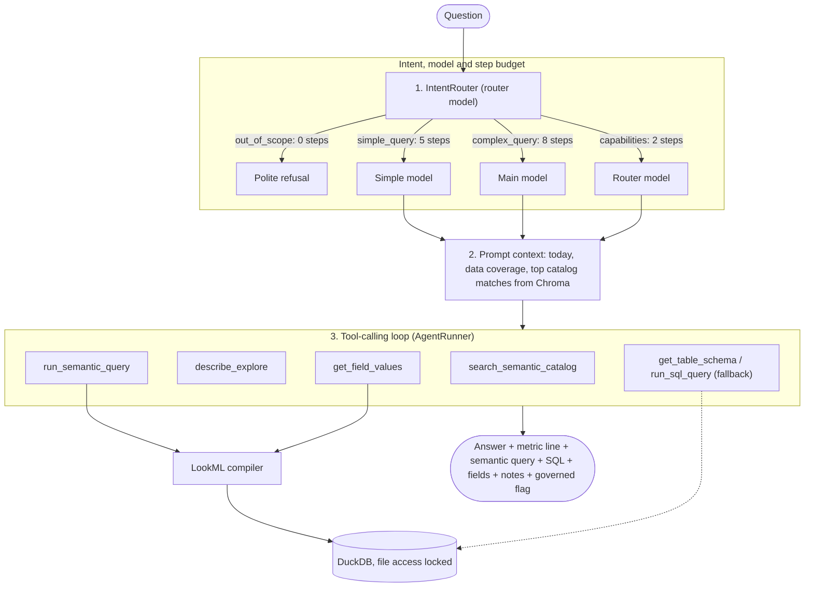

# Agent Architecture: Intent Routing, Semantic Tools & Traceable Answers

This document describes how the agent in `app/agent/` and `app/semantic/` turns a question into a number.

The key rule: **the model never writes metric SQL.** It chooses an explore, fields and filters from the LookML semantic layer, and a deterministic compiler writes the SQL. The same choice always gives the same SQL, and every metric uses its official LookML definition (refund netting, transfer exclusion, joins).

---

## 1. System Overview

---

## 2. Intent Router (`app/agent/router.py`)

The router model returns a structured `RouterDecision`:
- `intent`: one of the four categories below, with a short `reasoning`.
- `metric_search_phrase`: a search phrase such as "total spend net of refunds by category", used to query Chroma.
- `entity_keywords`: categories, merchants, accounts or labels named in the question.

| Intent | Model | Tools | Steps |
|:---|:---|:---|:---:|
| `out_of_scope` | router model | none | 0 |
| `capabilities` | router model | `search_semantic_catalog`, `describe_explore` | 2 |
| `simple_query` | simple model | semantic tools (+ raw SQL fallback) | 5 |
| `complex_query` | main model | semantic tools (+ raw SQL fallback) | 8 |

The raw SQL tools are only bound when `ALLOW_RAW_SQL_FALLBACK=True`.

---

## 3. Tools

1. **`search_semantic_catalog(query)`**: searches Chroma for explores, measures and dimensions only (tables are filtered out). Each line shows the field name, the explores it can be used in, and its description.
2. **`describe_explore(explore)`**: every visible field of an explore with its type and description.
3. **`get_field_values(explore, field, pattern)`**: distinct values of a dimension, so the model filters on `Restaurants & fast food` and not on a guess.
4. **`run_semantic_query(explore, fields, filters, sorts, limit)`**: compiles the query with the LookML compiler and runs it. Errors (unknown field, hidden field, bad filter) come back with suggestions so the model can correct itself.
5. **`get_table_schema(table)` and `run_sql_query(sql)`**: the raw read-only SQL fallback for exploratory questions no explore can answer. Answers built this way say so and return `governed: false`.

---

## 4. The LookML Compiler (`app/semantic/`)

- **`model.py`** parses views, explores, joins, dimension groups (one field per timeframe, e.g. `fct_transactions.transaction_month`), measure filters and derived tables with `lkml`. The model reloads when any `.lkml` file changes, and the Chroma catalog is rebuilt with it.
- **`compiler.py`** builds the SQL:
  - joins only the views the query needs (plus views their `sql_on` refers to, and inner joins);
  - `type: number` measures inline the measures they reference;
  - when a `one_to_many` join fans out rows, sums and averages use symmetric aggregates and counts use `COUNT(DISTINCT pk)`, so totals are never double counted;
  - dimension filters go to `WHERE`, measure filters to `HAVING`;
  - default order: time dimensions ascending, otherwise the first measure descending.
- **`dates.py`** resolves date filters into date ranges. "last month" is the previous full calendar month, "this month" is the current month to date, "last 3 months" means three complete months and "past 3 months" includes the current one. `AGENT_TODAY` can pin today's date.
- **`service.py`** runs compiled queries and adds coverage notes when a period is only partly covered by the data (e.g. "2026-10-01 to 2026-10-31 is only partly covered: the data runs through 2026-10-20").

Filter grammar: `Groceries,Rent` (either), `-Rent` (exclude), `%uber%` (contains), `^,` (a literal comma), `yes`/`no`, `>1000000`, `[100,500]`, `2026-09`, `2026-Q3`, `2026-01 through 2026-03`, `before 2026-06`, `last month`, `this year`.

---

## 5. Prompt Context and Token Cost

The system prompt holds the rules (default metrics, filter grammar, answer format) and a one-line list of explores. Field definitions are not dumped into the prompt: the runner searches Chroma with the router's phrase and entities and adds only the top `SEMANTIC_SEARCH_TOP_K` matches (default 12). Input tokens stay roughly flat as the LookML project grows; the model can still call `describe_explore` when it needs more.

---

## 6. Traceable Answers

Every `QueryResponse` includes:
- `answer`: leads with the number in COP and a "Metric:" line naming the metric in plain words;
- `semantic_query`: the explore, fields, filters and sorts used;
- `fields_used`: the LookML fields with their descriptions;
- `sql`: the compiled (or fallback) SQL;
- `data`: the rows behind the answer;
- `notes`: caveats such as partly covered periods or the raw-SQL warning;
- `governed`: `true` for LookML metrics, `false` for the raw SQL fallback;
- `thought_steps`: every tool call with its input and output.

---

## 7. Session Memory

- Keyed by `session_id`, with a 10-turn (20-message) window of clean question and answer pairs.
- Each saved answer carries the semantic query (or SQL) it used, so follow-ups like "and the month before?" can reuse it.
- Intermediate tool messages are dropped at the end of a turn, so Gemini never sees orphaned function calls.
- `GET /api/v1/agent/session/{session_id}` shows a session and `DELETE` resets it.

---

## 8. Security

DuckDB loads every table the LookML references into memory at start, then sets `enable_external_access=false` and `lock_configuration=true`. Agent SQL can't read files (`read_csv`, `read_parquet`, file paths) or change settings, and only `SELECT` and `WITH` statements run.

---

## 9. Testing

- `pytest`: unit tests plus 29 golden questions (`tests/golden/questions.json`) where the compiler's result must match a hand-written reference query. No Gemini calls.
- `pytest -m live`: the agent answers the golden questions through Gemini and its numbers are checked against the references. Spends credits; `GOLDEN_IDS=spend_sep,aug_vs_sep` limits the run.
