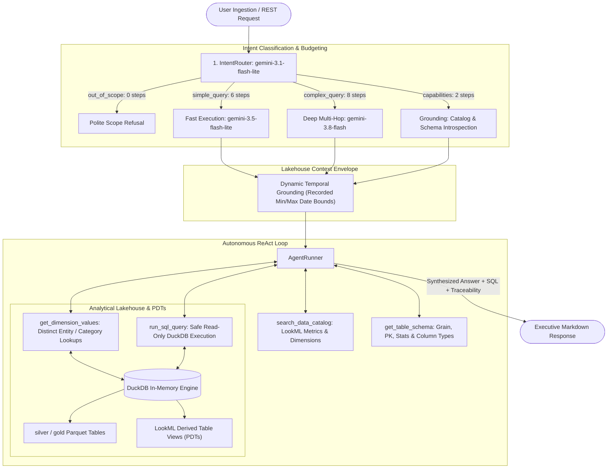

# Agent Architecture: Two-Step Intent Routing & Discrete Modular Semantic Tools

This document outlines the architecture, routing mechanics, tool definitions, and conversational memory powering the **Autonomous AI Data Agent** in `app/agent/`.

---

## 1. System Overview

The AI Data Agent is designed following industry patterns (Snowflake Cortex Analyst, Looker MCP, Cube, Wren AI). It bridges the context gap between natural language questions and the local DuckDB lakehouse via the **LookML semantic layer**:

---

## 2. Two-Step Intent Router (`app/agent/router.py`)

To optimize latency and token cost while preventing unnecessary exploratory tool loops, every incoming request first passes through [`IntentRouter`](file:///c:/projects/ai-data-agent/app/agent/router.py).

### Step 1: Classification & Semantic Decomposition (`gemini-3.1-flash-lite`)
`gemini-3.1-flash-lite` inspects the user prompt and outputs a structured `RouterDecision` with zero tools bound:
- **`intent` & `reasoning`**: Classifies the query into one of the 4 intent categories and explains the decision.
- **`metric_search_phrase`**: Decomposes the user inquiry into a natural semantic query phrase combining the metric/aggregation intent with domain context (e.g. `'total food spending expenses last month'`), optimized for dense vector cosine similarity search in `search_data_catalog`.
- **`entity_keywords`**: Extracts specific domain entities, category names, or account names (e.g. `['food', 'transportation']`), prepared for discrete categorical validation via `get_dimension_values`.

### Step 2: Routed Model & Discrete Tool Allocation
Based on the classified `intent`, `AgentRunner` selects the target Gemini model, allowed tools, and `max_iterations` ceiling:

| Intent Category | Target Execution Model | Allowed Tools | `max_iterations` | Purpose |
|:---|:---|:---|:---:|:---|
| `out_of_scope` | `gemini-3.1-flash-lite` | *None* | `0` | Politely declines non-financial/unrelated trivia questions without touching ChromaDB or DuckDB. |
| `capabilities` | `gemini-3.1-flash-lite` | `search_data_catalog`, `get_table_schema` | `2` | Grounds "what can you do?" responses in live indexed LookML tables and metric definitions. |
| `simple_query` | `gemini-3.5-flash-lite` | `search_data_catalog`, `get_table_schema`, `get_dimension_values`, `run_sql_query` | `6` | Fast, cost-efficient execution for single-metric lookups, category spend aggregations, and counts. |
| `complex_query` | `gemini-3.8-flash` | `search_data_catalog`, `get_table_schema`, `get_dimension_values`, `run_sql_query` | `8` | Deep multi-hop reasoning, period-over-period comparisons, Tier 1 vs Tier 2 reconciliations, and joins. |

---

## 3. Discrete Modular Semantic Tools

The agent interacts with the semantic layer and data lakehouse via 4 specialized, decoupled tools:

1. **`search_data_catalog(query: str)`**:
   - Searches the LookML semantic catalog via cosine similarity with an 80% relative cutoff.
   - Returns clean metric and dimension definitions with LookML calculation formulas, description notes, and view/table bindings.
   - Does **not** dump raw schema footers, preventing context window pollution.
2. **`get_table_schema(table_name: str)`**:
   - On-demand schema inspection for any physical Parquet table or LookML persistent derived table (PDT).
   - Returns explicit row grain, compound primary key, row count stats, date coverage (`min to max`), and column names with data types.
3. **`get_dimension_values(table_name: str, column_name: str, pattern: Optional[str], limit: int)`**:
   - Directly queries distinct categorical values (e.g. category names, merchants, accounts) from DuckDB matching an optional pattern.
   - SQL-injection safe: validates table and column names against live database metadata before executing parameterized queries.
   - Eliminates exploratory `SELECT DISTINCT` queries from the model's analytical step budget.
4. **`run_sql_query(sql: str)`**:
   - Executes safe read-only SQL queries against DuckDB views.
   - Regex-guarded against data modification statements (`DROP`, `DELETE`, `INSERT`, `ALTER`, `ATTACH`).

---

## 4. Autonomous ReAct Reasoning Loop

The core orchestration resides in [`AgentRunner.run_query()`](file:///c:/projects/ai-data-agent/app/agent/runner.py):

1. **Router Classification (`Step 1`)**: Records an `intent_router` thought step detailing the chosen intent, target model, and step budget.
2. **Dynamic Context Envelope Injection & Semantic Guidance**:
   - Dynamically inspects DuckDB (`duckdb_tool.get_temporal_bounds()`) to discover recorded lakehouse calendar bounds (`2026-01 to 2026-10`).
   - Injects the Context Envelope with zero-shot temporal grounding and semantic decomposition guidance (`metric_search_phrase` and `entity_keywords`), directing the agent to search the catalog with enriched domain phrases rather than isolated keywords.
3. **Unrestricted ReAct Iteration Step (up to `max_iterations`)**:
   - Passes message history to `routed_llm_with_tools.invoke(messages)`.
   - Allows natural multi-step introspection (e.g. search catalog $\rightarrow$ inspect values $\rightarrow$ execute SQL).
   - Captures each tool call output into an `AgentThoughtStep` for full observability.
   - **Self-Correction on Error**: If DuckDB returns an error, the raw error is returned to Gemini in the `ToolMessage` for automatic query refinement.
4. **Synthesis & Anti-Hallucination Directives**:
   - When Gemini outputs a response without tool calls (or when `max_iterations` is reached, using `tool_choice="none"`), it synthesizes a grounded analytical answer.
   - Strictly enforced **Absolute Financial Grounding**: the model is forbidden from inventing or extrapolating numbers. Every figure presented MUST come directly from rows returned by `run_sql_query`.

---

## 5. Multi-Turn Session Memory & Protocol Safety

Conversational memory enables natural back-and-forth financial exploration while maintaining strict Gemini API protocol compliance:

- **Keyed by Session ID**: Requests provide an optional `session_id` in `QueryRequest`.
- **Clean Dialogue Turn Persistence (`_save_session_turn`)**:
  - Across turns, session memory preserves clean conversational pairs (`HumanMessage` and `AIMessage`), appending the executed Lakehouse SQL query to the assistant message for semantic continuity.
  - Raw intermediate ReAct scratchpad messages (`ToolMessage` and intermediate function calls) are discarded upon turn completion. This guarantees that Gemini's API never encounters orphaned tool messages or turn-sequencing errors (`400 INVALID_ARGUMENT: function call turn must come immediately after a user turn or function response`).
- **Dynamic Context Envelope Refresh**: Every new turn begins with a fresh `SystemMessage` containing the latest Lakehouse temporal bounds and router semantic decomposition guidance.
- **Turn-Boundary Sliding Window**: Retains up to 10 clean conversation turns (20 dialogue messages), completely eliminating naive slicing across tool calls.
- **Reset Endpoint**: `DELETE /api/v1/agent/session/{session_id}` clears state on demand.
- **Session Inspection Endpoint**: `GET /api/v1/agent/session/{session_id}` returns active dialogue history, turn counts, and raw messages for live inspection.
- **Server Observability & Structured Logging**: The agent endpoint logs incoming queries, model routing, executed Lakehouse SQL queries, latency, and synthesized answers in real time (`>>> USER QUERY`, `<<< AGENT ANSWER`) for live monitoring and diagnostics.
