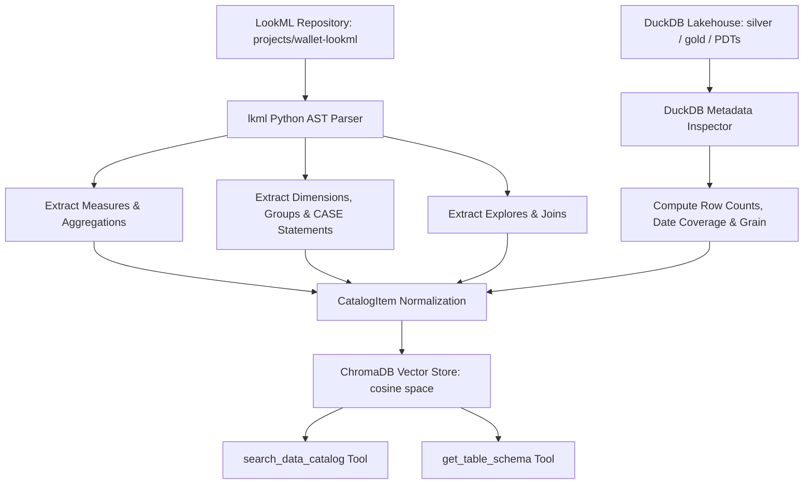

# Semantic RAG Indexer: LookML AST Extraction & Vector Catalog

This document details the AST parsing, semantic metadata transformation, and vector store indexing architecture that translates `projects/wallet-lookml` and local Parquet lakehouse tables into high-density vector representations for autonomous agent tool calling.

---

## 1. Overview & Architectural Role

The Semantic RAG Indexer bridges the gap between raw database schemas and the LLM agent by establishing the LookML semantic layer as the single source of truth:



---

## 2. LookML AST Parsing (`app/rag/indexer.py`)

The indexer uses the Python `lkml` parser to extract complete semantic metadata from `projects/wallet-lookml`:

1. **Dimensions & `CASE` Expressions**:
   - Extracts standard `sql` mappings as well as LookML `case: { when: ... else: ... }` blocks (compiled into `CASE WHEN ... THEN ... ELSE ... END` SQL formulas).
2. **Dimension Groups (`dimension_groups`)**:
   - Extracts time-based dimension groups (e.g. `transaction` with timeframes `[raw, time, date, week, month, quarter, year]`).
3. **Measures, Aggregation Wrappers & `filters__all`**:
   - Wraps measure SQL expressions in their LookML aggregation type (`sum` $\rightarrow$ `SUM(...)`, `average` $\rightarrow$ `AVG(...)`, `count` $\rightarrow$ `COUNT(...)`).
   - Extracts `filters__all` conditions and appends both a human-readable `[Filters: ...]` tag to the description and a `FILTER (WHERE ...)` clause to `sql_formula`:
     ```text
     [1] total_spend_usd (metric in fct_transactions | Table: master_records | SQL: SUM(ABS(${amount_usd})) FILTER (WHERE is_transfer = no AND amount_usd = <0) | score: 0.634 (distance: 0.366))
         Description: Total cash outflow in USD (excluding transfers) [Filters: is_transfer = no, amount_usd = <0]
     ```
4. **Models, Explores & Relational Joins (`models/**/*.model.lkml`)**:
   - Extracts `explores` and `joins` including `sql_on`, `relationship` (`many_to_one`), and `type` (`left_outer`).
5. **Decoupled Metric & Schema Retrieval Tools**:
   - `search_data_catalog` returns high-density, focused metric and dimension definitions with LookML SQL formulas and view bindings without dumping table schema footers.
   - Table schemas are decoupled into the dedicated `get_table_schema` tool, preventing context window bloat and eliminating table starvation.
6. **Universal Dynamic Table & PDT Metadata**:
   - DuckDB inspects all 8 tables and LookML persistent derived tables (PDTs like `pdt_category_mom_velocity`), dynamically capturing row counts (`COUNT(*)`) and calendar bounds (`MIN/MAX` over `date` or `year_month`):
     ```text
     [Table Schema: mart_expense_summary] Monthly expense summary segmented by accounting tier, category, merchant, and labels. Grain: 1 row per year_month + tier_group + category_name + merchant + labels. | Primary Key: expense_summary_pk | Stats: 550 rows | Date Coverage: 2026-01 to 2026-10 | Available columns: ...
     [Table Schema: pdt_category_mom_velocity] LookML Persistent Derived Table (PDT) tracking monthly category spend acceleration and 3-month rolling averages. Grain: 1 row per year_month + category_id. | Primary Key: velocity_key | Stats: 189 rows | Date Coverage: 2026-01 to 2026-10 | Available columns: ...
     ```

---

## 3. Cosine Similarity Scoring, Noise Floor & Dynamic 80% Relative Cutoff (`app/rag/store.py`)

To prevent low-relevance items from polluting the LLM context while ensuring single-word entity lookups (e.g. `"groceries"`, `"rent"`, `"salary"`) are never dropped:

- **Cosine Distance Collection**: ChromaDB is initialized with `metadata={"hnsw:space": "cosine"}`.
- **Similarity Formula**:
  $$\text{similarity\_score} = \max(0.0, \text{round}(1.0 - \text{distance}, 4))$$
- **Absolute Noise Floor (`RAG_MIN_SIMILARITY = 0.20`)**:
  - Drops true out-of-domain noise (e.g. *"weather forecast in bogota"* which scores `< 0.19`).
- **Dynamic 80% Relative Cutoff (`RAG_RELATIVE_CUTOFF_RATIO = 0.80`)**:
  - Rather than applying a single rigid threshold, the indexer evaluates the top match's score (`top_score`) and sets:
    $$\text{cutoff} = \max(\text{noise\_floor}, \text{round}(\text{top\_score} \times 0.80, 4))$$
  - All candidate items with $\text{similarity\_score} \ge \text{cutoff}$ are retained up to `top_k`.
  - This allows domain entity queries scoring `0.22`–`0.27` to succeed on the first catalog search without hardcoding entity lists.
